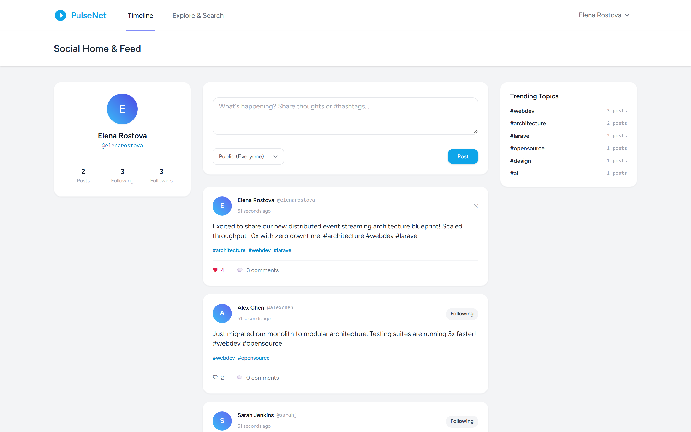
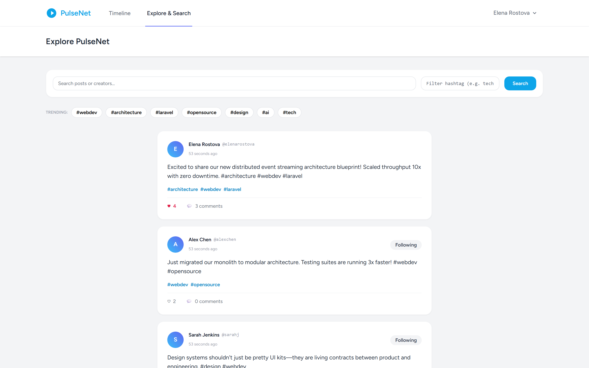
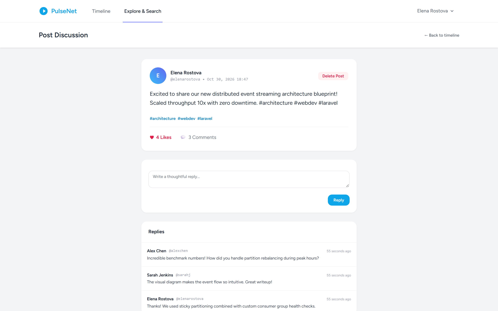
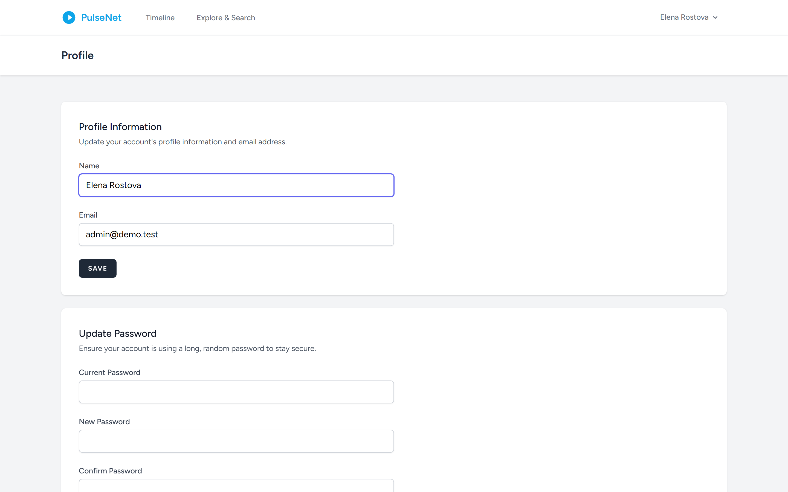

# Social Media Platform (Laravel 12 / Breeze / Tailwind / SQLite)

A modern social networking platform built with Laravel, Tailwind CSS, and Blade. Features timeline feeds, explore feeds, creator profiles, hashtag parsing, comment threads, follow graphs, and atomic like interactions.

## Features

- **Timeline & Explore Feeds**: Dual-feed architecture providing a personalized stream of followed creators and a global discovery feed with keyword and hashtag searching.
- **Hashtag Discovery Engine**: Automatic regex extraction of hashtags (`#tag`) upon post creation, tracking trending topics and frequency metrics.
- **Social Graph & Relationships**: Follow and unfollow users with bidirectional follower/following counters and self-follow prevention.
- **Engagement Interactions**: Real-time post liking and comment threads with atomic counter incrementing and decrementing inside `DB::transaction()`.
- **Responsive Community UI**: Clean desktop and mobile social layouts with rich author avatars, timestamp formatting, and hashtag chips.

## Screenshots

| Tampilan | Preview |
|---|---|
| **Timeline Feed & Beranda Komunitas**<br>Stream linimasa postingan kreator yang diikuti, formulir pembuat postingan cepat, profil statistik kreator, dan topik tren teratas |  |
| **Pencarian & Penjelajahan Tagar Global**<br>Feed eksplorasi global dengan pencarian kata kunci multi-parameter, penyaringan tagar topik, dan daftar tren interaktif |  |
| **Utas Diskusi & Interaksi Postingan**<br>Halaman detail percakapan lengkap dengan balasan komentar bertingkat, formulir interaksi, serta metrik suka atomik |  |
| **Manajemen Akun & Pengaturan Profil**<br>Pusat kendali pengaturan identitas pengguna, pembaharuan kata sandi, dan privasi akun |  |

---

## Tech Stack

- **Backend**: Laravel 12.x (PHP 8.3+)
- **Authentication**: Laravel Breeze
- **Database**: SQLite (local & testing), PostgreSQL ready
- **Frontend**: Blade, Tailwind CSS, Vite

## Setup & Testing

```bash
cp .env.example .env
php artisan key:generate
touch database/database.sqlite
php artisan migrate
npm install
npm run build
php artisan test
```
